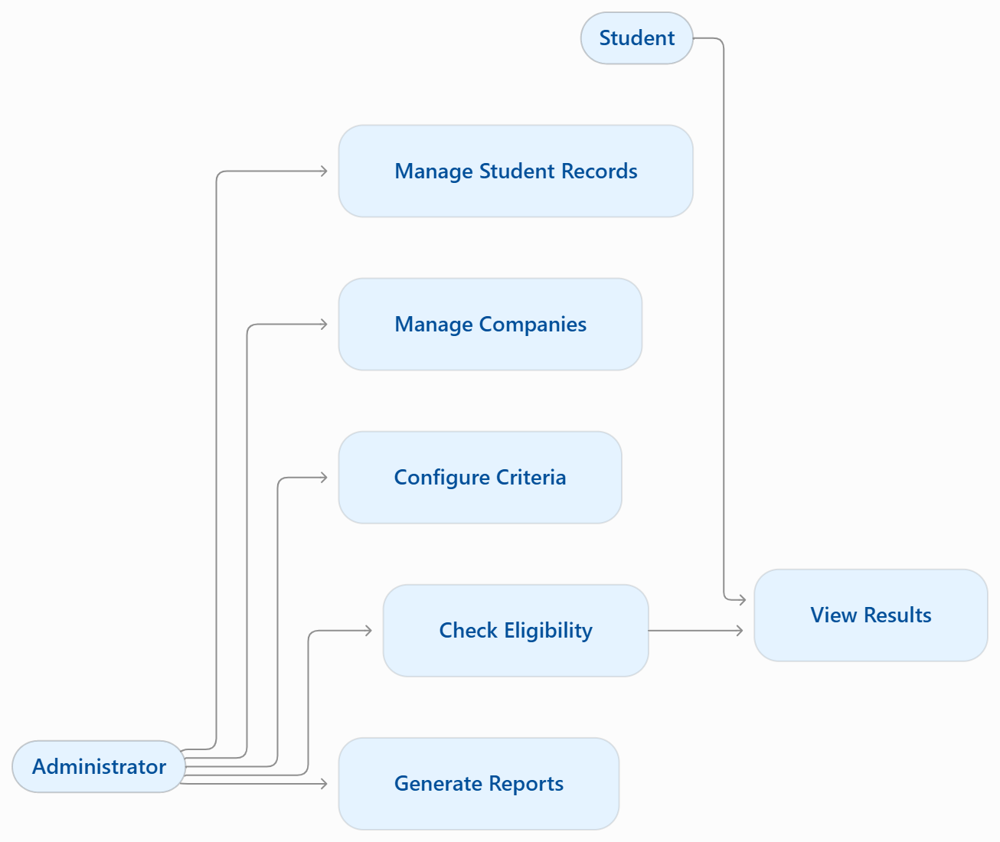

1. User roles

Administrator / Placement Officer
- Log in securely.
- Add, update, search, and delete student records.
- Add companies and manage eligibility criteria.
- Run eligibility checks and view results.
- View summary statistics and manage project data.
Student
- View their registered academic details.
- Check eligibility for available companies.
- View eligible or not-eligible status and reasons.
- Search available companies and their requirements.
Project Developer / Maintainer
- Configure the application and database.
- Maintain source code and resolve errors.
- Manage backups and test application updates.
This is a development responsibility, not necessarily a separate login role.

2. **Abstract – Placement Eligibility Checker**

The Placement Eligibility Checker is a Java-based software application developed to simplify and automate the campus placement eligibility process in colleges. Students often face difficulties in determining whether they qualify for different companies because every organization has different eligibility criteria, such as minimum CGPA, academic percentage, active backlogs, graduation year, and required technical skills.
The proposed system provides a centralized platform where student academic information and company-specific placement requirements can be stored and managed. The application compares student records with the eligibility conditions specified by a company and generates clear results indicating whether a student is eligible or ineligible. It can also display the reasons for ineligibility, helping students understand which requirements they have not satisfied.
The system includes student management, company and eligibility criteria management, eligibility checking, and administrative reporting modules. Java Swing can be used to develop the graphical user interface, while MySQL stores student details, company information, eligibility criteria, and checking results. JDBC provides connectivity between the Java application and the database.
The main objective of this project is to reduce manual effort, minimize errors, improve transparency, and make placement eligibility checking faster and more efficient. The application can be further enhanced with resume analysis, email notifications, and integration with college placement portals.

3. Problem statement
The existing placement eligibility process often involves manually checking student records against different company requirements. This process is time-consuming, repetitive, and prone to errors. Students may also remain unaware of their eligibility for particular companies.
The proposed Placement Eligibility Checker automates these comparisons and provides accurate, understandable eligibility results based on configured criteria.

4. Objectives
- Automate student placement eligibility checking.
- Maintain student academic and personal records.
- Store company-specific eligibility requirements.
- Identify eligible and ineligible students.
- Display the reasons for ineligibility.
- Reduce manual work and checking errors.
- Generate eligibility reports for students and placement administrators.

5. Team formation and guide selection
Project title-[Placement Eligibility Checker]
Team leader	[Nandani kumari(24EARCS100)]
Member 2	[komal Agarwal(24EARCS077)]
Member 3	[Muskan Singh(24EARCS099)]
Member 4	[Kashish(24EARCS073)]
Member 5	[Nency Jain(24EARCS102)]
Project guide	[ER.RAM BABU BURI]
Department	[Computer Science and Engineering]
Project type-	Project-Based Learning (PBL)
Academic year	[2024-2028]

## 📌 Academic Context & Project Overview

**Institution:** Department of Computer Science and Engineering  
**Academic Program:** Bachelor of Technology (B.Tech) in Computer Science and Engineering  
**Academic Context:** Java Project-Based Learning (PBL)  
**Project Title:** Placement Eligibility Checker  
**Project Type:** Java-Based Student Placement Management System  
**Project Duration:** 10 Weeks  
**Team Size:** 5 Members  
**Project Guide:** Faculty Guide (to be confirmed)  
**Primary Integration Branch:** `integration/placement-eligibility-checker`

### Project Description

The **Placement Eligibility Checker** is a Java-based application designed to help students determine whether they satisfy company-specific placement eligibility criteria.

The system evaluates student information such as CGPA, academic backlogs, percentage of marks, graduation details, and other requirements defined by a recruiting company. It compares the student's academic profile against the eligibility rules and displays whether the student is eligible or ineligible for a particular placement opportunity.

The application aims to simplify preliminary placement screening, reduce manual verification, improve accuracy, and provide a centralized system for students and placement administrators.

The system can also maintain student records, company eligibility criteria, placement opportunities, and eligibility assessment results.

## 🧩 Module Ownership & Git Branch Mapping

The project is divided into five independent modules. Each student is responsible for developing and testing one module. All modules are integrated through a common integration branch before the final release.

| Module | Scope & Core Responsibilities | Assigned Feature Branch |
|---|---|---|
| **Module 1: Authentication & User Management** | Login, logout, registration, input validation, user roles, and session management where applicable | `feature/authentication` |
| **Module 2: Student Profile Management** | Student details, enrollment number, department, semester, CGPA, academic history, and backlog information | `feature/student-profile` |
| **Module 3: Company & Placement Management** | Company registration, job opportunities, eligibility requirements, minimum CGPA, academic percentages, and backlog limits | `feature/placement-management` |
| **Module 4: Eligibility Evaluation Engine** | Comparison of student academic data with company criteria, eligibility calculation, and reason-wise results | `feature/eligibility-engine` |
| **Module 5: Admin Dashboard & Reports** | Student and company record management, eligibility summaries, report generation, and system integration | `feature/admin-dashboard` |

### Git Branching Strategy

- `main` — stable, final project version.
- `integration/placement-eligibility-checker` — combined modules and integration testing.
- `feature/authentication` — authentication development.
- `feature/student-profile` — student profile development.
- `feature/placement-management` — placement and company criteria development.
- `feature/eligibility-engine` — eligibility logic development.
- `feature/admin-dashboard` — administration and reporting development.

Each team member should commit work to their assigned branch and create a pull request for integration.

---

## 🏗️ System Architecture & Layered Design

The application follows a modular architecture separating the user interface, application logic, and database operations.

```text
+------------------------------------------------------+
|                  PRESENTATION LAYER                  |
|                                                      |
|       Java Swing Forms / User Interface              |
|       Login | Student Profile | Placement Search     |
|       Eligibility Results | Admin Dashboard          |
+------------------------------------------------------+
                         |
                         v
+------------------------------------------------------+
|                  APPLICATION LAYER                   |
|                                                      |
| Authentication Service                               |
| Student Management Service                           |
| Company & Placement Service                          |
| Eligibility Evaluation Service                       |
| Reporting & Administration Service                   |
+------------------------------------------------------+
                         |
                         v
+------------------------------------------------------+
|                    DATA ACCESS LAYER                 |
|                                                      |
| Student DAO | User DAO | Company DAO                 |
| Placement DAO | Eligibility DAO                      |
| JDBC | PreparedStatement | CRUD Operations           |
+------------------------------------------------------+
                         |
                         v
+------------------------------------------------------+
|                     DATABASE LAYER                   |
|                                                      |
|                    MySQL Database                    |
|                                                      |
| Users | Students | Companies | Placements            |
| Eligibility Criteria | Assessment Results             |
+------------------------------------------------------+
```

**Architecture components:**

1. **Presentation Layer:** Collects user inputs and displays placement eligibility results.
2. **Application Layer:** Implements validation, business rules, eligibility calculations, and workflows.
3. **Data Access Layer:** Performs database operations using JDBC and DAO classes.
4. **Database Layer:** Stores student records, company criteria, placement details, and assessment results.

*If your current implementation uses Java Swing, this architecture applies directly. If it uses a web interface, replace the presentation layer with the actual web technology.*

---

## ⚙️ Core Functional Modules

### 1. Authentication & User Management

- User registration and login, if required by the approved scope.
- Input validation and appropriate error messages.
- Role-based access for students and administrators, if implemented.
- Session or login-state management, depending on the application type.

### 2. Student Profile Management

- Maintain student name, enrollment number, department, and course.
- Record CGPA and academic percentages.
- Store current backlogs and historical backlogs when required.
- Validate student data before saving it.

### 3. Company & Placement Management

- Maintain company details and placement opportunities.
- Define company-specific academic eligibility criteria.
- Configure minimum CGPA and percentage requirements.
- Specify allowed backlog limits and other approved conditions.

### 4. Eligibility Evaluation Engine

The eligibility engine compares the student's academic information with the requirements of a selected company.

Example eligibility conditions:

| Criterion | Example Requirement | Student Record |
|---|---|---|
| Minimum CGPA | 7.00 | 7.80 |
| Class 10 Percentage | 60% | 75% |
| Class 12 Percentage | 60% | 68% |
| Current Backlogs | 0 | 0 |

**Illustrative result:** Eligible, assuming all configured conditions are satisfied.

The thresholds above are examples only. Actual criteria must be configurable and based on the selected company's requirements.

### 5. Admin Dashboard & Reports

- Manage student and company records.
- Add and update placement opportunities.
- Review eligibility assessments.
- Display eligible and ineligible student counts.
- Generate reports, if included in the final implementation.


## 🗄️ Database Schema & Relational Structure

The database can be organized into the following core tables. The final SQL schema should reflect the fields and relationships actually implemented.

### Key Database Entities

**1. `users`**

Stores login information and user roles, if authentication is implemented.

Suggested fields: `user_id`, `username`, `password_hash`, `role`, `created_at`.

**2. `students`**

Stores student identity and academic information.

Suggested fields: `student_id`, `enrollment_no`, `full_name`, `department`, `cgpa`, `class10_percentage`, `class12_percentage`, `current_backlogs`, `total_backlogs`.

**3. `companies`**

Stores recruiting company details.

Suggested fields: `company_id`, `company_name`, `industry`, `contact_email`, `description`.

**4. `placements`**

Stores job opportunities and recruitment details.

Suggested fields: `placement_id`, `company_id`, `job_title`, `job_description`, `application_deadline`, `status`.

**5. `eligibility_criteria`**

Stores company- or placement-specific requirements.

Suggested fields: `criteria_id`, `placement_id`, `minimum_cgpa`, `minimum_class10_percentage`, `minimum_class12_percentage`, `maximum_current_backlogs`, `maximum_total_backlogs`.

**6. `eligibility_results`**

Stores the outcome of an eligibility evaluation, if assessment history is required.

Suggested fields: `result_id`, `student_id`, `placement_id`, `is_eligible`, `reason`, `evaluated_at`.

### Proposed Entity Relationships

- One company can offer multiple placement opportunities.
- One placement opportunity can have one configured eligibility criteria record, or multiple versions if criteria history is required.
- One student can have multiple eligibility assessment results.
- Each assessment result links a student to a placement opportunity.

## 📐 UML Diagrams

### 1. Use Case Diagram


### 2. Class Diagram
.png)

### 3. Activity Diagram
.png)

### 4. Sequence Diagram
.png)

### 5. ER Diagram
.png)


## 📅 10-Week Comprehensive Project Log

### WEEK 1: Team Formation, Guide Selection & Abstract

**Objectives:** Finalize the project idea, team responsibilities, and problem statement.

**Activities:**
- Formed a team of five members.
- Discussed the manual placement eligibility verification process.
- Identified the project scope and intended users.
- Selected the project guide and prepared the abstract for portal submission.

**Deliverables:** Project abstract, team details, problem statement, and initial GitHub repository.

**Outcome:** Established the project foundation and assigned preliminary responsibilities.

### WEEK 2: Software Requirements Specification (SRS)

**Objectives:** Document functional and non-functional requirements.

**Activities:**
- Identified student and administrator workflows.
- Specified student academic data and company eligibility criteria.
- Defined validation rules, error handling, and expected results.
- Documented functional requirements and system constraints.

### WEEK 3: UML Design

**Objectives:** Design the system structure and behavior.

**Activities:**
- Created the use case diagram and class diagram.
- Prepared activity and sequence diagrams.
- Defined module interactions and class responsibilities.
- Reviewed the diagrams against the SRS.

**Deliverables:** UML diagram set and system design documentation.

**Outcome:** Established the software design before implementation.

### WEEK 4: Database Design & UI Mock-ups

**Objectives:** Design database tables and user interfaces.

**Activities:**
- Identified entities, primary keys, foreign keys, and relationships.
- Designed student, company, placement, and eligibility records.
- Prepared login, student profile, eligibility result, and admin screen mock-ups.
- Reviewed form fields and validation messages.

### WEEK 5: Core Project Setup & Authentication

**Objectives:** Establish the project structure and implement the initial application infrastructure.

**Activities:**
- Created the Java project and organized packages.
- Configured the MySQL connection through JDBC, if MySQL is the selected database.
- Created common validation and database utility classes.
- Began authentication and navigation components.

**Deliverables:** Initial Java application, project structure, database connection, and authentication module draft.

**Outcome:** Established the core development environment.

### WEEK 6: Student Profile Management

**Objectives:** Implement student records and academic information management.

**Activities:**
- Developed student profile forms.
- Implemented create, read, update, and delete operations as required.
- Added validation for CGPA, percentage, and backlog fields.
- Tested student record storage and retrieval.

**Deliverables:** Student profile module and database operations.

**Outcome:** Enabled the application to manage academic information.

### WEEK 7: Company & Placement Management

**Objectives:** Implement placement opportunities and company eligibility criteria.

**Activities:**
- Developed company and placement management forms.
- Implemented criteria configuration for placement opportunities.
- Connected placement records with the relevant company records.
- Tested saving, updating, and retrieving eligibility requirements.

**Deliverables:** Company management module, placement module, and criteria configuration.

**Outcome:** Enabled the application to maintain company-specific placement rules.

### WEEK 8: Eligibility Evaluation & Admin Dashboard

**Objectives:** Implement the eligibility engine and administrative functionality.

**Activities:**
- Developed the eligibility evaluation service.
- Compared student academic records against configured criteria.
- Displayed eligibility results and reasons for unmet conditions.
- Integrated the admin dashboard and reporting features included in the scope.

**Deliverables:** Eligibility evaluation engine, results interface, and admin features.

**Outcome:** Completed the primary business functionality.

### WEEK 9: Integration, Testing & Bug Fixes

**Objectives:** Integrate modules and verify end-to-end functionality.

**Activities:**
- Merged reviewed feature branches into the integration branch.
- Tested student data management and placement criteria.
- Checked eligibility calculations for eligible and ineligible cases.
- Fixed integration errors, invalid inputs, and database issues.

**Deliverables:** Integrated application, test cases, test results, and bug-fix log.

**Outcome:** Prepared a stable version for final validation.

### WEEK 10: Final Report, PPT, Video & Viva

**Objectives:** Complete the academic submission and demonstrate the application.

**Activities:**
- Prepared the final project report and presentation.
- Captured screenshots of the implemented application.
- Recorded a demonstration video, if required.
- Reviewed the SRS, UML diagrams, database schema, and testing evidence.
- Prepared viva questions and answers.

## 🔐 Security & Data Integrity

- Validate all user inputs before processing.
- Use parameterized SQL queries with `PreparedStatement` when using JDBC.
- Store passwords using a suitable salted password-hashing algorithm if authentication is implemented.
- Restrict administrative operations according to the configured user roles.
- Protect database credentials and API keys from source control.
- Enforce database constraints and validate records before saving.
- Avoid exposing sensitive student information in reports or logs.

## 🚀 Future Enhancements

- Import student records from Excel or CSV.
- Add company-wise eligibility comparison.
- Generate downloadable eligibility reports.
- Add email notifications for new placement opportunities.
- Provide dashboards showing eligible students for each company.
- Add placement application tracking.
- Implement audit history and role-based permissions.
- Develop a web-based version if required in the future.

## 📚 Academic Attribution

This project is developed as part of the **Bachelor of Technology (B.Tech) Computer Science and Engineering Project-Based Learning (PBL)** 

The project is intended to demonstrate software engineering practices, object-oriented programming, database design, modular development, UML modeling, testing, GitHub collaboration, and project documentation.

**Project:** Placement Eligibility Checker  
**Team Size:** 5 Members  
**Duration:** 10 Weeks  
**Guide:** Er. Ram Babu Buri
**Academic Year:** 2026
